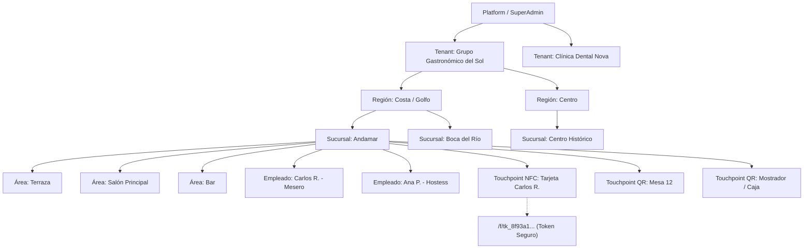
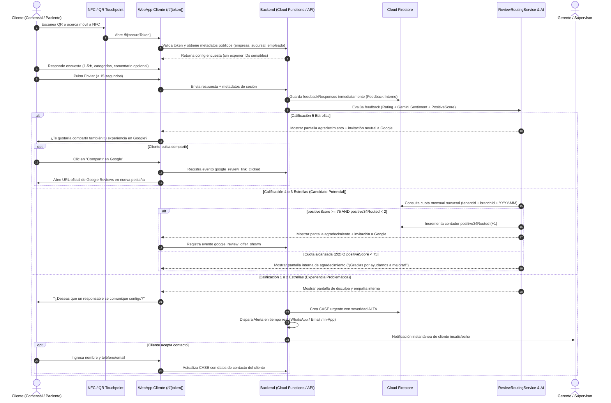

# Arquitectura del Sistema: ValoraCX (SaaS Multi-Tenant)

## 1. Visión General del Producto
**ValoraCX** es una plataforma SaaS multi-tenant diseñada para negocios físicos (restaurantes, cafeterías, hoteles, retail, clínicas, salones de belleza y empresas de servicios) orientada a la captura ultra-rápida de feedback de clientes en el punto de experiencia (vía NFC y QR), gestión de reputación online con enrutamiento inteligente y ético a Google Reviews, medición individual de colaboradores, gestión de incidentes y recuperación de clientes insatisfechos, analítica predictiva con IA (Gemini) y fidelización transaccional mediante billeteras digitales.

---

## 2. Principios de Arquitectura

1. **Aislamiento Multi-Tenant Estricto:** Ningún tenant puede leer o modificar datos de otro tenant bajo ninguna circunstancia. Toda consulta e índice incluye `tenantId`.
2. **Experiencia del Cliente Sin Fricción (<20 segundos):**
   - Acceso anónimo o con consentimiento explícito.
   - Sin descargas de apps, sin contraseñas, sin páginas intermedias.
   - URLs tokenizadas seguras: `/f/{secureToken}` (sin IDs secuenciales ni datos legibles en URL).
3. **Enrutamiento Ético y Transparente de Reseñas:**
   - La encuesta interna **siempre** se persiste.
   - El feedback negativo nunca se elimina y se gestiona internamente para mejora continua y recuperación del cliente.
   - Motor `ReviewRoutingService` que evalúa satisfacción real (`rating`, `sentiment`, `positiveScore`, cuotas mensuales de 3-4★ por sucursal).
   - Estricta separación de métricas: `google_review_offer_shown` vs `google_review_link_clicked`. Nunca se presume `published`.
4. **Patrón Adapter / Ports & Adapters:**
   - Servicios externos (WhatsApp Cloud API, Gemini AI, Google Business Profile, Google Wallet, Apple Wallet) implementados tras interfaces uniformes con proveedores `Live` y `Mock` para permitir funcionamiento inmediato autónomo.
5. **Transaccionalidad en Fidelización:**
   - Toda alteración de puntos ocurre a través de un libro contable inmutable (`pointsLedger`), nunca mutando directamente un campo flotante `balance`.
6. **Mobile-First PWA:**
   - Interfaz del comensal/cliente ultraligera, optimizada para conexiones móviles lentas.
   - Panel administrativo responsivo, accesible y moderno en modo claro/oscuro.

---

## 3. Jerarquía Multi-Tenant

---

## 4. Diagrama de Flujo: Feedback y Enrutamiento a Google Reviews

---

## 5. Módulos del Sistema

| Módulo | Responsabilidad |
|---|---|
| **Identity & Access (IAM/RBAC)** | Autenticación, perfiles, membresías multi-sucursal y verificación de permisos por rol. |
| **Touchpoint & Token Engine** | Generación de tokens seguros no secuenciales, QR SVG/PNG descargables, enlace NFC y conteo de interacciones. |
| **Survey Engine** | Diseñador visual de encuestas, lógica condicional, renderizado mobile-first ultraligero y seguro. |
| **ReviewRoutingService** | Algoritmo estricto de selección ética para Google Reviews con control de cuota mensual 3-4★ por sucursal. |
| **Inbox & Incident Management (Cases)** | Bandeja unificada de feedback, creación automática de casos para 1-2★, asignación, SLAs y seguimiento hasta resolución. |
| **Recovery & Compensations** | Emisión de cupones, cortesías y compensaciones trazables vinculadas al caso y al cliente. |
| **Loyalty & Points Ledger** | Monedero de fidelización transaccional con contabilidad inmutable de puntos, recompensas y canje en sucursal. |
| **Wallet Pass Layer** | Abstracción para Google Wallet y Apple Wallet (mock funcional + estructura de pases oficiales). |
| **AI Intelligence Hub (Gemini)** | Análisis de sentimiento, clasificación de motivos raíz, resúmenes operativos y asistente interactivo "Pregúntale a tus datos". |
| **Reputation Analytics & Calculator** | Métricas de Google vs Feedback Interno, cálculo matemático de reseñas 5★ necesarias para metas de rating y funnel de conversión. |
| **SuperAdmin SaaS Platform** | Gestión global de inquilinos, control de planes (Trial, Basic, Pro, Enterprise), límites y logs de auditoría. |

---

## 6. Arquitectura de Despliegue y Ejecución

- **Frontend & API Routes:** Next.js con App Router y Server Actions / Route Handlers.
- **Base de Datos & Almacenamiento:** Cloud Firestore (NoSQL optimizado para aislamiento de tenant y tiempo real) + Cloud Storage.
- **Lógica de Fondo & Triggers:** Firebase Cloud Functions Gen 2 / Edge Handlers.
- **Capa Mock & Adaptadores:**
  - `WhatsAppNotificationAdapter`: Modo Mock (consola / in-app preview) + Modo Live (WhatsApp Cloud API).
  - `GeminiAIAdapter`: Modo Mock determinista y semántico inteligente + Modo Live (`@google/genai` o REST API).
  - `WalletPassAdapter`: Generador mock interactivo de tarjetas + endpoints listos para Apple PassKit / Google Wallet REST.
  - `DatabaseAdapter`: Soporte nativo para Cloud Firestore con emulación/mock local desacoplada para pruebas y desarrollo continuo.
