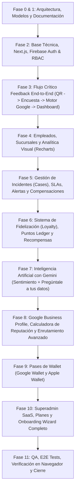

# Plan de Implementación: ValoraCX

Este plan detalla la hoja de ruta de ejecución fase por fase para construir la plataforma SaaS multi-tenant ValoraCX con rigor de ingeniería, verificación funcional y cero deuda técnica.

---

## Fases de Desarrollo

---

## Desglose por Fase

### Fase 0 & 1: Especificación y Arquitectura (Completada)
- [x] Requisitos analizados a fondo.
- [x] `architecture.md`
- [x] `data-model.md`
- [x] `security-model.md`
- [x] `implementation-plan.md`
- [x] `DECISIONS.md`
- [x] `PROJECT_STATUS.md`

### Fase 2: Fundación Técnica y Setup
- Inicialización del proyecto Next.js 15+ con App Router, TypeScript y Tailwind CSS.
- Configuración de UI components (estilo shadcn/ui, diseño minimalista SaaS, soporte dark/light mode).
- Configuración de Firebase Client y Firebase Admin SDK con adaptador de persistencia desacoplado (Memory/Local Firestore Emulator ready + Cloud Firestore production ready).
- Sistema de Autenticación, sesión multi-tenant y RBAC en contexto de aplicación.
- Layout principal del dashboard administrativo con navegación por rol y selector de tenant/sucursal.

### Fase 3: Feedback Loop End-to-End (Hito Crucial de la Definition of Done)
- Módulo de creación y gestión de Touchpoints (NFC & QR).
  - Generación de QR en SVG y PNG descargables.
  - Generación de tokens seguros criptográficos (`/f/{secureToken}`).
  - Asociación a sucursal, empleado, mesa y área.
- Experiencia pública del cliente (`/f/[token]`):
  - Carga instantánea ultra-rápida (< 1 seg), mobile-first.
  - Identificación del empleado ("Te atendió Carlos R.").
  - Formulario fluido de 10-20 segundos: 1-5 estrellas, categorías, comentario opcional.
  - Honeypot anti-spam y deduplicación con hash anonimizado.
- Motor `ReviewRoutingService`:
  - 5★: Ofrecimiento neutral de Google Review sin límite.
  - 4★ y 3★: Algoritmo de elegibilidad (`positiveScore >= 75`, `sentiment === POSITIVE`, cuota mensual `<= 2` por sucursal).
  - 1-2★: Agradecimiento empático interno, solicitud opcional de contacto, creación de CASE interno.
  - Registro disociado de eventos: `google_review_offer_shown` y `google_review_link_clicked`.
- Dashboard de recepción de feedback en tiempo real.

### Fase 4: Analítica de Empleados, Sucursales y Visualización
- Dashboard de Colaboradores:
  - Ficha individual, ranking por satisfacción interna (sin métricas tóxicas de Google reviews).
  - Comparativa contra promedio de sucursal.
- Dashboard de Sucursales:
  - Comparativas A vs B vs C, distribución de estrellas, volumen por franja horaria y heatmap.
- Visualizaciones interactivas con Recharts (evolución temporal, desglose de categorías, NPS).

### Fase 5: Incident Management (Cases), Alertas y Compensaciones
- Ciclo de vida de Casos: Nuevo -> Revisando -> Contactado -> Compensación enviada -> Resuelto -> Cerrado.
- SLAs con temporizador y alertas por vencimiento.
- Módulo de Compensaciones:
  - Generación de cupones con código único y QR.
  - Trazabilidad de envío y validación de canje.
- Sistema de Alertas multicanal:
  - Reglas automáticas (<=2 estrellas, palabras clave críticas).
  - Adaptadores: In-app, Email y WhatsApp Cloud API (con Mock Provider realista).

### Fase 6: Loyalty & Rewards (Fidelización Transaccional)
- Creación de cuenta de cliente y monedero de lealtad.
- Libro contable inmutable de puntos (`pointsLedger`): movimientos `earn`, `redeem`, `adjustment`, `expiration`.
- Catálogo de recompensas con límite de stock y vigencia.
- Interfaz de validación de canjes para colaboradores en caja/mostrador.

### Fase 7: Inteligencia Artificial con Gemini
- Proveedor Gemini (Live API + Mock semántico inteligente).
- Clasificación de sentimientos, severidad e intención en cada feedback.
- Detección de patrones y anomalías operativas.
- Módulo interactivo "Pregúntale a tus datos" con aislamiento estricto de tenant.

### Fase 8: Integración de Reputación Google & Calculadora
- Funnel de Google Reviews (Encuestas -> Elegibles -> Ofrecidas -> Clics -> CTR).
- Visualización de cuotas mensuales 3-4★ por sucursal y fecha de reinicio.
- Calculadora de Reputación Matemática (estimación de reseñas 5★ necesarias para meta de rating público).

### Fase 9: Pases de Billetera Digital (Google Wallet & Apple Wallet)
- Capa de abstracción `WalletPassAdapter`.
- Visualizador de tarjeta de lealtad digital para el cliente con QR de membresía y saldo de puntos.
- Estructura lista para Google Wallet JWT y Apple PassKit `.pkpass`.

### Fase 10: Superadmin SaaS y Onboarding Wizard
- Asistente de configuración inicial en 7 pasos para nuevos negocios.
- Panel Superadmin SaaS para administrar tenants, monitoreo y planes de suscripción (Trial, Basic, Pro, Enterprise).

### Fase 11: Demo Data, Pruebas y Verificación
- Carga de datos realistas: "Restaurante Demo", 3 sucursales (Centro, Andamar, Norte), 5 empleados (Ana, Luis, Carlos, Sofía, Diego), 150+ feedbacks, casos, recompensas y alertas.
- Tests automatizados (Unit, Integration, Security).
- Verificación exhaustiva en navegador mediante la herramienta de navegación.
